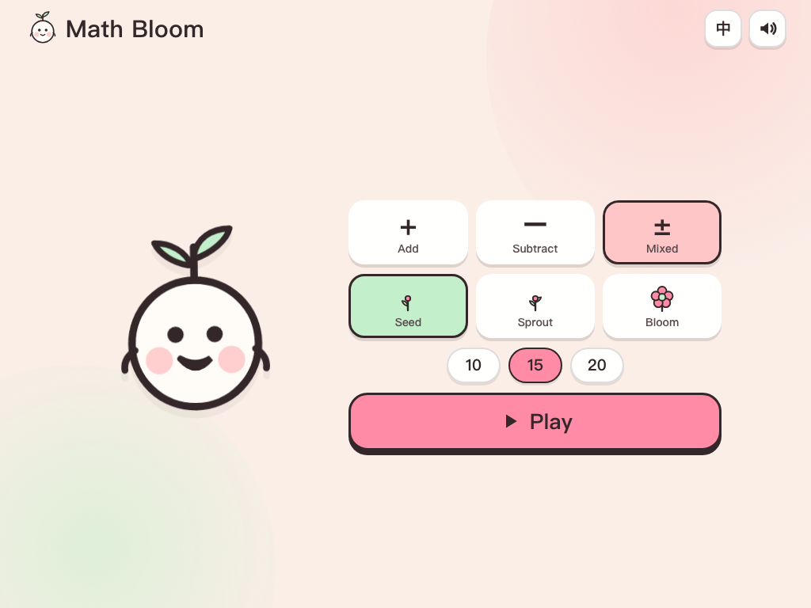

# Math Bloom 🌼

A cute, fully static addition & subtraction quiz for 7–9 year olds.
Generated questions, Duolingo-style flow, a big number keypad, visual
micro-explanations and a flower-garden result screen.

**Live:** <https://rhysmic.github.io/math-bloom/>



## Why

A printable worksheet is a one-off. This is a small web app a child can replay:
the questions are generated fresh every round, the difficulty adapts, and every
mistake comes with a four-step picture explanation instead of a paragraph.

It is pure front-end: no backend, no accounts, no analytics, nothing leaves the
device. Progress and best scores live in `localStorage`.

## Features

- **Three levels** — Seed (within 20, make-ten), Sprout (two-digit, no
  regrouping), Bloom (carrying & borrowing, missing operands).
- **Adaptive ramp** — three first-try wins in a row step the level up; two misses
  step it back. Always bounded to ±1 around the level the child picked.
- **10 / 15 / 20 questions**, addition, subtraction or mixed.
- **Big keypad** — 64 px+ targets, physical keyboard works too.
- **Visual explanations** — ten-frames, base-ten blocks, number lines and bar
  models, at most four steps with three-word captions.
- **Gentle feedback** — one retry, no lives or timers, mint "correct" states.
- **Result garden** — three stars, time, best streak, every question as a flower
  (or a bud you can tap to see how it is solved).
- **Sound** — WebAudio chimes only, no audio files, mute toggle.
- **English / 简体中文**, auto-detected, one-tap switch.
- **Tablet-first responsive layout** — two-pane landscape iPad/Android tablet,
  single-column phone, safe-area aware, installable via manifest.
- **Resumable** — refreshing mid-quiz picks up where you left off.

## Design

Palette: [Happy Hues #15](https://www.happyhues.co/palettes/15) —
`#FAEEE7` cream, `#33272A` ink, `#FF8BA7` strawberry, `#FFC6C7` blush,
`#C3F0CA` mint. Type: Baloo 2 (numerals/headings) + Nunito (labels), self-hosted
through `@fontsource` so the app makes no third-party requests.

## Develop

```bash
pnpm install
pnpm dev        # http://localhost:5173
pnpm test       # vitest, core logic happy paths
pnpm typecheck
pnpm build      # static output in dist/
```

## Structure

```
src/
  App.tsx                 # screen state machine + persistence
  game/
    questions.ts          # constrained generator per level/operation
    session.ts            # quiz session, adaptive level, resume snapshots
    score.ts              # stars, streaks, summary
    explain.ts            # explanation step models
    storage.ts            # localStorage store
  components/
    visuals/              # ten-frame, base-ten blocks, number line, bar model
  styles/                 # tokens + layout
tests/                    # generator, scoring, explanation models
```

## Deploy

Pushes to `main` run the GitHub Actions workflow, test, build and publish `dist`
to GitHub Pages.
